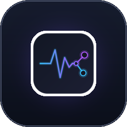
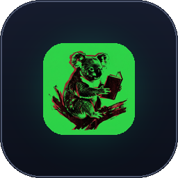
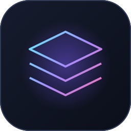

  

  
  
  
  
  
  
  

  <a href="#english">English</a> ·
  <a href="#русский">Русский</a> ·
  <a href="https://boosty.to/xronni/single-payment/donation/809763/target?share=target_link">Boosty</a>

---

## English

I've been writing code since 2021. Most projects start the same way: a tool almost does what I need, so I dig into how it works and build the version I actually want.

- **Languages** — Python 3.10+, Rust 1.98+, Go 1.26+, Bash.
- **Desktop** — GTK4 and Libadwaita on Linux, PyQt6 on Linux and Windows.
- **Systems** — X11/EWMH window handling, D-Bus/MPRIS, git plumbing, LevelDB records, `.deb` packaging.
- **AI** — cloud models (OpenAI, Anthropic, Gemini, DeepSeek, OpenCode) and local `.gguf` models through `llama-cpp`.

## Projects

<table width="100%">
<tr>
<td width="96" align="center" valign="middle">
  
</td>
<td valign="top">
  <h3><a href="https://github.com/Xronni/git-pulse-hud">GitPulse HUD</a></h3>
  
  
  
Git companion for Linux: micro-staging, branch graph, Conventional Commits and repository analytics.

  
Cairo branch tree with one-click checkout · pre-commit secret scan under 3 ms

  
<a href="https://github.com/Xronni/git-pulse-hud"><b>Open repository →</b></a>

  
</td>
</tr>
</table>

<table width="100%">
<tr>
<td width="96" align="center" valign="middle">
  
</td>
<td valign="top">
  <h3><a href="https://github.com/Xronni/spotify-mini-player">Spotify Mini Player</a></h3>
  
  
  
Translucent mini-player and OSD HUD for Spotify on Linux.

  
Real queue from the local LevelDB cache, no API tokens · MPRIS volume sync, global media keys, four themes

  
<a href="https://github.com/Xronni/spotify-mini-player"><b>Open repository →</b></a>

  
</td>
</tr>
</table>

<table width="100%">
<tr>
<td width="96" align="center" valign="middle">
  
</td>
<td valign="top">
  <h3><a href="https://github.com/Xronni/yaread">YaRead</a></h3>
  
  
  
PyQt6 reader for PDF, EPUB and FB2 with in-text AI.

  
Ask AI explains any selected passage in place · twelve narrative emotions drive adaptive soundtracks

  
<a href="https://github.com/Xronni/yaread"><b>Open repository →</b></a>

  
</td>
</tr>
</table>

<table width="100%">
<tr>
<td width="96" align="center" valign="middle">
  
</td>
<td valign="top">
  <h3>Toolbox</h3>
  
  
  
  
  
  
  
<b>Languages</b> Python 3.10+, Rust 1.98+, Go 1.26+, Bash <b>Desktop</b> GTK4, Libadwaita, PyQt6, Cairo <b>Systems</b> X11, D-Bus, LevelDB, git <b>AI</b> OpenAI, Anthropic, Gemini, DeepSeek, OpenCode, llama-cpp

  
</td>
</tr>
</table>

---

## Русский

Пишу код с 2021 года. Почти каждый проект начинается одинаково: готовый инструмент делает почти то, что нужно, — я разбираюсь, как он устроен, и собираю версию, которой мне не хватает.

- **Языки** — Python 3.10+, Rust 1.98+, Go 1.26+, Bash.
- **Десктоп** — GTK4 и Libadwaita под Linux, PyQt6 под Linux и Windows.
- **Системы** — работа с окнами через X11/EWMH, D-Bus/MPRIS, внутренности git, записи LevelDB, сборка `.deb`.
- **ИИ** — облачные модели (OpenAI, Anthropic, Gemini, DeepSeek, OpenCode) и локальные `.gguf` через `llama-cpp`.

## Проекты

<table width="100%">
<tr>
<td width="96" align="center" valign="middle">
  
</td>
<td valign="top">
  <h3><a href="https://github.com/Xronni/git-pulse-hud">GitPulse HUD</a></h3>
  
  
  
Git-компаньон для Linux: микро-стейджинг, граф веток, Conventional Commits и аналитика репозитория.

  
Граф веток на Cairo с переключением в один клик · проверка staged-диффа на утёкшие ключи, меньше 3 мс

  
<a href="https://github.com/Xronni/git-pulse-hud"><b>Открыть репозиторий →</b></a>

  
</td>
</tr>
</table>

<table width="100%">
<tr>
<td width="96" align="center" valign="middle">
  
</td>
<td valign="top">
  <h3><a href="https://github.com/Xronni/spotify-mini-player">Spotify Mini Player</a></h3>
  
  
  
Полупрозрачный мини-плеер и OSD HUD для Spotify под Linux.

  
Настоящая очередь из локального кэша LevelDB, без токенов API · синхронизация по MPRIS, медиаклавиши, четыре темы

  
<a href="https://github.com/Xronni/spotify-mini-player"><b>Открыть репозиторий →</b></a>

  
</td>
</tr>
</table>

<table width="100%">
<tr>
<td width="96" align="center" valign="middle">
  
</td>
<td valign="top">
  <h3><a href="https://github.com/Xronni/yaread">YaRead</a></h3>
  
  
  
Читалка PDF, EPUB и FB2 на PyQt6 с ИИ прямо в тексте.

  
Ask AI объясняет выделенный фрагмент на месте · двенадцать эмоций сцены управляют саундтреком

  
<a href="https://github.com/Xronni/yaread"><b>Открыть репозиторий →</b></a>

  
</td>
</tr>
</table>

<table width="100%">
<tr>
<td width="96" align="center" valign="middle">
  
</td>
<td valign="top">
  <h3>Toolbox</h3>
  
  
  
  
  
  
  
<b>Языки</b> Python 3.10+, Rust 1.98+, Go 1.26+, Bash <b>Десктоп</b> GTK4, Libadwaita, PyQt6, Cairo <b>Системы</b> X11, D-Bus, LevelDB, git <b>ИИ</b> OpenAI, Anthropic, Gemini, DeepSeek, OpenCode, llama-cpp

  
</td>
</tr>
</table>

---

  If the tool you need doesn't exist — build it.

